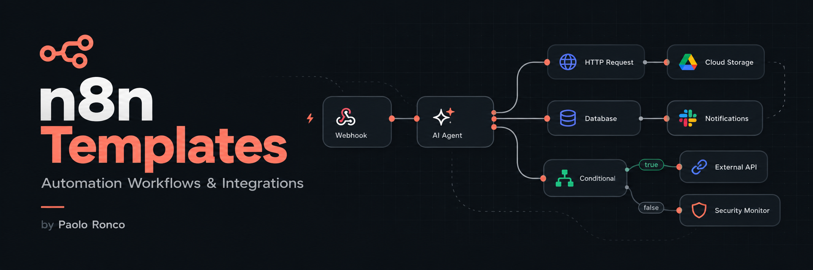

# n8n Templates — Paolo Ronco

A curated collection of n8n automation workflows, practical implementation guides and reusable assets. Templates are organized by solution, with variants and releases grouped together.

  

## Template catalog

**Free** workflows include importable JSON and setup resources. **Paid** templates retain their existing delivery model; their workflow JSON files are not publicly distributed here.

### Free templates

| Template | Description | GitHub | Gumroad | n8n Creators | Setup guide |
|---|---|---|---|---|---|
| OrbitPage AI Page Editor | Edit OrbitPage pages through AI chat, review validated previews and approve publication. | [Folder](./free-templates/orbitpage-ai-page-editor/) | [View](https://paoloronco.gumroad.com/l/orbitpage-ai-pageeditor) | — | [Guide](./free-templates/orbitpage-ai-page-editor/README.md) |
| OrbitPage Release Guardian | Monitor website revisions, verify published pages, approve private drafts and request human-approved rollback after failed checks. | [Folder](./free-templates/orbitpage-release-guardian/) | — | — | [Guide](./free-templates/orbitpage-release-guardian/README.md) |
| Website AI Chatbot | Authenticated website RAG chatbot with OpenAI, Qdrant, Cohere reranking and structured JSON responses. | [Folder](./free-templates/website-ai-chatbot/) | [View](https://paoloronco.gumroad.com/l/ai-website-chatbot) | [View](https://n8n.io/workflows/20208-run-an-english-website-chatbot-with-openai-gpt-5-and-qdrant/) | [Guide](https://paoloronco.notion.site/Website-AI-Chatbot-404f0ba27c32807bad10d69e95ef3179?pvs=73) |
| WordPress Voiceovers — Google Cloud TTS | Generate multilingual WordPress audio with Google Cloud TTS and Translate. | [Folder](./free-templates/wordpress-ai-voiceovers/) | [View](https://paoloronco.gumroad.com/l/wordpress-voiceovers) | [View](https://n8n.io/workflows/11789-convert-wordpress-articles-to-multilingual-voiceovers-with-google-tts-and-openai/) | [Guide](./free-templates/wordpress-ai-voiceovers/docs/00%20Home.md) |
| Amazon Luna Prime Games | Synchronize included-with-Prime games with Google Sheets. | [Folder](./free-templates/amazon-luna-prime-games/) | — | [View](https://n8n.io/workflows/10733-sync-amazon-luna-prime-games-to-google-sheets-with-automatic-updates/) | [Guide](https://paoloronco.it/writing/amazon-luna-fetch-included-with-prime-games) |
| Invoice Archiving & Data Extraction | Gmail invoice extraction and archiving (v1 / v2). | [Folder](./free-templates/invoice-archiving/) | [V1](https://paoloronco.gumroad.com/l/invoice-archiving) · [V2](https://paoloronco.gumroad.com/l/invoice-archivingtracking) | [V1](https://n8n.io/workflows/10923-automatic-email-invoice-archiving-and-data-extraction-with-gmail-drive-and-ai/) | [V1](https://paoloronco.it/writing/n8n-template-automated-invoice-archiving) · [V2](./free-templates/invoice-archiving/V2/README.md) |
| Digital Certificate Creation & Validation | HTML/CSS PDF or PDF Generator API variants. | [Folder](./free-templates/digital-certificates/) | — | [Templates](https://n8n.io/workflows/11886-create-and-validate-digital-certificates-with-pdf-generator-api-and-gmail/) | [Article&nbsp;v1](https://paoloronco.it/writing/n8n-template-certification-creator-checker)&nbsp;·&nbsp;[Article&nbsp;v2](https://paoloronco.it/writing/n8n-template-certification-creator-checker-with-pdfgenerationapi-templates) |
| Tech & AI News Digest | RSS collection, AI ranking, summaries and email delivery. | [Folder](./free-templates/tech-ai-news-digest/) | [View](https://paoloronco.gumroad.com/l/tech-news) | — | [Guide](https://paoloronco.it/writing/n8n-template-rss-tech-news-to-your-inbox) |
| Instagram Reel to Notion Second Brain | Save public Instagram Reels as structured Notion knowledge using Telegram, Apify and OpenAI. Italian and English output variants available. | [Folder](./free-templates/instagram-reel-second-brain/) | [View](https://paoloronco.gumroad.com/l/instagram-notion-secondbrain) | — | [Guide](https://paoloronco.notion.site/Documentation-Instagram-Reel-to-Notion-Second-Brain-404f0ba27c3281e1b7e0cd5159fb6bc7?pvs=73) |
| Menu Order Notifications | Basic ntfy, Home Assistant TTS and BAC tracking variants. | [Folder](./free-templates/menu-order-notifications/) | [V3](https://paoloronco.gumroad.com/l/n8n-menuwebsite-ordernotifications) | [V3](https://n8n.io/workflows/14487-notify-on-menu-orders-via-ntfy-and-home-assistant-tts-with-daily-bac-tracking/) | [V1](https://paoloronco.notion.site/Documentation-Menu-Order-Push-Notifications-48bf0ba27c3282fcb5e50148e52fb8cd) · [V2](https://paoloronco.notion.site/Documentation-Menu-Order-Push-Notifications-Home-Assistant-TTS-849f0ba27c32836e844101b86f496c55) · [V3](https://paoloronco.notion.site/Documentation-Menu-Order-Push-Notifications-Home-Assistant-TTS-BAC-033f0ba27c3282719669018ae292091b) |
| Splunk Security Alert Notifications | Basic notifications and enriched/deduplicated alert processing. | [Folder](./free-templates/splunk-alert-notifications/) | [V1](https://paoloronco.gumroad.com/l/n8n-splunknotifications?layout=profile) · [V2](https://paoloronco.gumroad.com/l/splunk-securityalert) | [V2](https://n8n.io/workflows/19906-enrich-and-route-splunk-security-alerts-via-abuseipdb-email-and-telegram/) | [V1](./free-templates/splunk-alert-notifications/v1/README.md) · [V2](./free-templates/splunk-alert-notifications/v2/README.md) |
| Newsletter & Release Announcements | Subscriber management, welcomes and GitHub release emails. | [Folder](./free-templates/newsletter-automation/) | [View](https://paoloronco.gumroad.com/l/newslettersub-newrelease) | [View](https://n8n.io/workflows/20636-send-newsletter-welcomes-and-release-announcements-with-github-openai-and-smtp/) | [Guide](./free-templates/newsletter-automation/README.md) |
| Google Cloud Inventory & Change Audit | Resource inventory and change tracking. | [Folder](./free-templates/google-cloud-inventory/) | [View](https://paoloronco.gumroad.com/l/GoogleCloud-InventoryChangeAudit) | — | [Guide](https://www.notion.so/402f0ba27c32801ba303f2549dbe9fa2) |
| Backup & Sync Execution Validation | Log-driven validation of scheduled backup/sync jobs. | [Folder](./free-templates/backup-sync-monitoring/) | [View](https://paoloronco.gumroad.com/l/ReliableBackup-SyncExecutionValidation) | [View](https://n8n.io/workflows/12880-monitor-backup-and-sync-logs-with-google-cloud-storage-github-gmail-openai-and-glpi/) | [Guide](https://paoloronco.notion.site/Documentation-Reliable-Backup-Sync-Execution-Validation-Log-Driven-403f0ba27c3280179a84fb206e06481a?pvs=74) |
| AI News → Instagram Publishing | Generate social posts from RSS news and publish them to Instagram using AI and Cloudinary. | [Folder](./free-templates/ai-instagram-publishing/) | [View](https://paoloronco.gumroad.com/l/AInews-SocialPubblishing) | [View](https://n8n.io/workflows/11791-automate-rss-to-instagram-with-ai-generated-content-and-cloudinary/) | [Guide](https://paoloronco.notion.site/Documentation-n8n-RSS-AI-Instagram-Publishing-3f5f0ba27c32806ba425f7d84c72961a?pvs=74) |

A dash indicates that no public listing was found in the repository or Notion catalog. Linked listings may describe an earlier release.

## Folder conventions

- `free-templates/` and `paid-templates/` remain separate until the distribution model changes.
- Solution directories use descriptive, lowercase kebab-case names without numeric prefixes.
- Functional alternatives use descriptive names (e.g. `basic/`, `home-assistant-tts/`); successive releases use `v1/`, `v2/`.
- Each solution has a README with variant selection, import instructions and relevant resources. Existing assets, examples and supporting documentation are retained.
- Menu order notifications use `V1/` (Basic), `V2/` (Home Assistant TTS), and `V3/` (Home Assistant TTS + BAC). Shared website mockups and common setup documentation live once in the solution folder.

## Importing a workflow

1. Open the relevant template folder and read its README.
2. Download the applicable workflow JSON (free templates) or obtain the paid package through its linked distribution channel.
3. Import the JSON into n8n and configure credentials, endpoints and environment-specific values.
4. Test manually before activating production triggers.

## Professional services

Need help implementing or adapting these workflows to your environment? For consulting and implementation inquiries, contact [info@paoloronco.it](mailto:info@paoloronco.it) or visit [paoloronco.it](https://paoloronco.it).

## Resources

- [n8n Creator profile](https://n8n.io/creators/paoloronco/)
- [n8n guides](https://paoloronco.it/portfolio/n8n-guides/)
- [n8n documentation](https://docs.n8n.io/)

Maintained by [Paolo Ronco](https://paoloronco.it).
