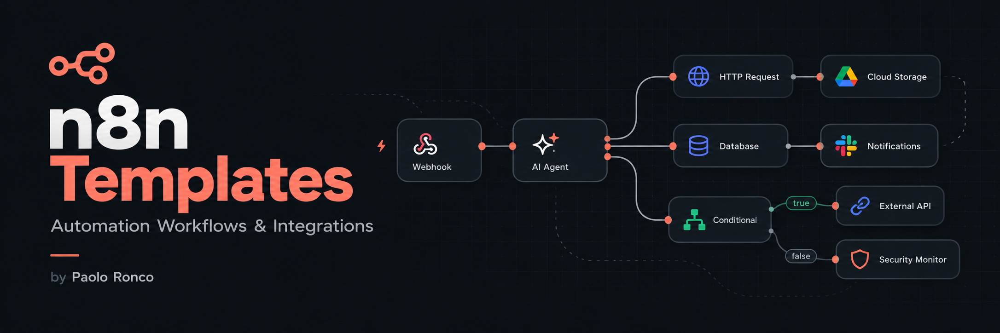

# n8n Templates — Paolo Ronco

A curated collection of n8n automation workflows, practical implementation guides and reusable assets. Templates are organized by solution, with variants and releases grouped together.

  

## Template catalog

Browse by topic. Each workflow name opens its GitHub folder; the remaining columns link to its n8n Creators listing, Gumroad package and setup guide.

- [OrbitPage](#orbitpage)
- [Social media and video](#social-media-and-video)
- [Websites and WordPress](#websites-and-wordpress)
- [Documents and business operations](#documents-and-business-operations)
- [Knowledge and productivity](#knowledge-and-productivity)
- [Monitoring and maintenance](#monitoring-and-maintenance)

### OrbitPage

Page content, campaign launches, event updates and release checks. Browse the [OrbitPage collection](./workflows/orbitpage/) for an overview.

| Workflow and files | Description | n8n Creators | Gumroad | Setup guide |
| --- | --- | --- | --- | --- |
| [Sync Google Sheets Menus and Price Lists to OrbitPage](./workflows/orbitpage/sync-google-sheets-menus-and-price-lists-to-orbitpage/) | Sync approved sheet rows to a native menu section with previews, email review and preserved unrelated content. | [View](https://n8n.io/workflows/22130-sync-approved-google-sheets-menu-items-with-orbitpage-native-menus/) | — | [Guide](./workflows/orbitpage/sync-google-sheets-menus-and-price-lists-to-orbitpage/README.md) |
| [Add New YouTube Videos to OrbitPage](./workflows/orbitpage/add-new-youtube-videos-to-orbitpage/) | Add new YouTube videos as native players, automatically or after email approval. No YouTube API key. | [View](https://n8n.io/workflows/22127-publish-new-youtube-videos-to-orbitpage-with-optional-email-approval/) | — | [Guide](./workflows/orbitpage/add-new-youtube-videos-to-orbitpage/README.md) |
| [OrbitPage AI Page Editor](./workflows/orbitpage/orbitpage-ai-page-editor/) | Edit OrbitPage pages through AI chat, review validated previews and approve publication. | [View](https://n8n.io/workflows/21795-edit-and-publish-orbitpage-site-content-with-openai-chat-approval/) | [View](https://paoloronco.gumroad.com/l/orbitpage-ai-pageeditor) | [Guide](./workflows/orbitpage/orbitpage-ai-page-editor/README.md) |
| [OrbitPage Release Guardian](./workflows/orbitpage/orbitpage-release-guardian/) | Monitor website revisions, verify published pages, approve private drafts and request human-approved rollback after failed checks. | [View](https://n8n.io/workflows/21773-guard-orbitpage-releases-with-gmail-approvals-and-rollback-controls/) | — | [Guide](./workflows/orbitpage/orbitpage-release-guardian/README.md) |
| [Update an OrbitPage Event Before, During and After](./workflows/orbitpage/orbitpage-event-lifecycle/) | Publish approved event phases at one stable URL, with guarded revisions, a durable journal and a reusable local QR. | [View](https://n8n.io/workflows/22354-publish-phased-orbitpage-event-pages-with-email-approvals-and-data-tables/) | [View](https://paoloronco.gumroad.com/l/orbitpage-event-lifecycle) | [Guide](./workflows/orbitpage/orbitpage-event-lifecycle/README.md) |
| [Build an OrbitPage Campaign Page with Ad Copy, UTM Links and QR](./workflows/orbitpage/orbitpage-campaign-launch-kit/) | Review one offer, publish its campaign subpage, verify the result and deliver matching ad copy, UTM links and a local QR. | [View](https://n8n.io/workflows/22355-publish-orbitpage-campaign-pages-with-email-approvals-and-qr-launch-kits/) | [View](https://paoloronco.gumroad.com/l/orbitpage-campaign-launch-kit) | [Guide](./workflows/orbitpage/orbitpage-campaign-launch-kit/README.md) |
| [Review OrbitPage Analytics and Approve One CTA Improvement](./workflows/orbitpage/orbitpage-analytics-improvement/) | Send a measured analytics report and optionally review and publish one exact server-previewed CTA title improvement. | [View](https://n8n.io/workflows/22356-send-weekly-orbitpage-analytics-reports-and-review-one-ai-cta-change-via-email/) | [View](https://paoloronco.gumroad.com/l/orbitpage-analytics-improvement) | [Guide](./workflows/orbitpage/orbitpage-analytics-improvement/README.md) |

### Social media and video

| Workflow and files | Description | n8n Creators | Gumroad | Setup guide |
| --- | --- | --- | --- | --- |
| [Social Reels & Shorts — Local Worker or Cloud](./workflows/social/social-reels-shorts/) | V1 local worker and V2 cloud: HeyGen HyperFrames, Shotstack, JSON2Video. All options in one package. | — | [View](https://paoloronco.gumroad.com/l/social-reels) | [README](./workflows/social/social-reels-shorts/README.md) · [Guide](https://paoloronco.notion.site/41af0ba27c32817490eeff675e958ce2) |
| [Social Posts & Carousels — Local Worker or Cloud](./workflows/social/social-posts-carousels/) | V1 local worker and V2 cloud: Creatomate, Shotstack, JSON2Video. All options in one package. | — | [View](https://paoloronco.gumroad.com/l/social-posts) | [README](./workflows/social/social-posts-carousels/README.md) · [Guide](https://paoloronco.notion.site/41af0ba27c3281e7a8c3c9434b6efbbe) |
| [Video Production — Local Worker or Cloud](./workflows/social/video-production/) | V1 local worker and V2 cloud: HeyGen HyperFrames, NextCut. All options in one package. | — | [View](https://paoloronco.gumroad.com/l/social-local-videoproduction) | [README](./workflows/social/video-production/README.md) · [Guide](https://paoloronco.notion.site/41af0ba27c3281f7b166e83346bbbb4c) |
| [AI News → Instagram Publishing](./workflows/ai-instagram-publishing/) | Generate social posts from RSS news and publish them to Instagram using AI and Cloudinary. | [View](https://n8n.io/workflows/11791-automate-rss-to-instagram-with-ai-generated-content-and-cloudinary/) | [View](https://paoloronco.gumroad.com/l/AInews-SocialPubblishing) | [Guide](https://paoloronco.notion.site/3f5f0ba27c32806ba425f7d84c72961a) |

### Websites and WordPress

| Workflow and files | Description | n8n Creators | Gumroad | Setup guide |
| --- | --- | --- | --- | --- |
| [Website AI Chatbot](./workflows/website-ai-chatbot/) | Authenticated website RAG chatbot with OpenAI, Qdrant, Cohere reranking and structured JSON responses. | [View](https://n8n.io/workflows/20208-run-an-english-website-chatbot-with-openai-gpt-5-and-qdrant/) | [View](https://paoloronco.gumroad.com/l/ai-website-chatbot) | [Guide](https://paoloronco.notion.site/404f0ba27c32807bad10d69e95ef3179) |
| [WordPress AI Chatbot](./workflows/wordpress-ai-chatbot/) | AI chatbot with a WordPress plugin, website frontend and MongoDB indexing tools. | — | — | [Guide](https://paoloronco.notion.site/404f0ba27c3281c796fbfc177b050bef) · [Plugin](./workflows/wordpress-ai-chatbot/Frontend-wordpressPlugin%26Website/wordpress-ai-chatbot-plugin/README.md) |
| [WordPress VoiceOvers — Multilingual Google Cloud TTS](./workflows/wordpress-ai-voiceovers/) | Automatically generate and publish multilingual WordPress voiceovers with Google Cloud TTS, translation, retry queue and change detection. | [View](https://n8n.io/workflows/22712-create-multilingual-wordpress-audio-players-with-google-sheets-and-cloud-run/) | [View](https://paoloronco.gumroad.com/l/wordpress-voiceovers) | [Guide](./workflows/wordpress-ai-voiceovers/README.md) |
| [Newsletter & Release Announcements](./workflows/newsletter-automation/) | Subscriber management, welcomes and GitHub release emails. | [View](https://n8n.io/workflows/20636-send-newsletter-welcomes-and-release-announcements-with-github-openai-and-smtp/) | [View](https://paoloronco.gumroad.com/l/newslettersub-newrelease) | [Guide](./workflows/newsletter-automation/README.md) |

### Documents and business operations

| Workflow and files | Description | n8n Creators | Gumroad | Setup guide |
| --- | --- | --- | --- | --- |
| [Invoice Archiving & Data Extraction](./workflows/invoice-archiving/) | Gmail invoice processing and archiving (V1/V2/V3; V3 adds Google Drive, review queue and recovery). | [V1](https://n8n.io/workflows/10923-automatic-email-invoice-archiving-and-data-extraction-with-gmail-drive-and-ai/) | [V1](https://paoloronco.gumroad.com/l/invoice-archiving) · [V2](https://paoloronco.gumroad.com/l/invoice-archivingtracking) | [V1](https://paoloronco.it/writing/n8n-template-automated-invoice-archiving) · [V2](./workflows/invoice-archiving/V2/README.md) · [V3](./workflows/invoice-archiving/V3/README.md) |
| [Digital Certificate Creation & Validation](./workflows/digital-certificates/) | HTML/CSS PDF or PDF Generator API variants. | [View](https://n8n.io/workflows/11886-create-and-validate-digital-certificates-with-pdf-generator-api-and-gmail/) | — | [Article&nbsp;v1](https://paoloronco.it/writing/n8n-template-certification-creator-checker) [Article&nbsp;v2](https://paoloronco.it/writing/n8n-template-certification-creator-checker-with-pdfgenerationapi-templates) |
| [Menu Order Notifications](./workflows/menu-order-notifications/) | V1–V3 releases plus V4 staging: smart order alerts, TTS, BAC tracking, fallbacks and daily reports. | [V3](https://n8n.io/workflows/14487-notify-on-menu-orders-via-ntfy-and-home-assistant-tts-with-daily-bac-tracking/) | [V3](https://paoloronco.gumroad.com/l/n8n-menuwebsite-ordernotifications) | [V1](https://paoloronco.notion.site/48bf0ba27c3282fcb5e50148e52fb8cd) · [V2](https://github.com/paoloronco/n8n-templates/blob/main/workflows/menu-order-notifications/V2/README.md) · [V3](https://github.com/paoloronco/n8n-templates/blob/main/workflows/menu-order-notifications/V3/README.md) · [V4 Staging](./workflows/menu-order-notifications/V4/README.md) |

### Knowledge and productivity

Capture content, build a knowledge base and track useful information. Compare [Second Brain versions](./workflows/secondbrain/) to choose the right release.

| Workflow and files | Description | n8n Creators | Gumroad | Setup guide |
| --- | --- | --- | --- | --- |
| [Build an AI Second Brain with Telegram, OpenAI & Notion — v4](./workflows/secondbrain/v4/) | Capture Instagram, TikTok, YouTube, webpages, screenshots and ideas as English Notion summaries with suggested tasks. | — | — | [Guide](./workflows/secondbrain/v4/README.md) |
| [Telegram Multimodal to Notion Second Brain — v3](./workflows/secondbrain/v3/) | Capture Instagram, TikTok, webpages, screenshots and rough ideas from Telegram as concise English Notion notes and tasks. | — | [View](https://paoloronco.gumroad.com/l/telegram-notion-secondbrain-v3) | [Guide](./workflows/secondbrain/v3/README.md) |
| [Instagram Reel to Notion Second Brain — v2](./workflows/secondbrain/v2/) | Save public Instagram Reels as structured Notion knowledge using Telegram, Apify and OpenAI. Italian and English output variants available. | [View](https://n8n.io/workflows/21770-save-instagram-reels-as-structured-notion-pages-with-telegram-apify-and-openai/) | [View](https://paoloronco.gumroad.com/l/instagram-notion-secondbrain) | [Guide](https://github.com/paoloronco/n8n-templates/blob/main/workflows/secondbrain/v2/README.md) |
| [Tech & AI News Digest](./workflows/tech-ai-news-digest/) | RSS collection, AI ranking, summaries and email delivery. | — | [View](https://paoloronco.gumroad.com/l/tech-news) | [Guide](https://paoloronco.it/writing/n8n-template-rss-tech-news-to-your-inbox) |
| [Amazon Luna Prime Games](./workflows/amazon-luna-prime-games/) | Synchronize included-with-Prime games with Google Sheets. | [View](https://n8n.io/workflows/10733-sync-amazon-luna-prime-games-to-google-sheets-with-automatic-updates/) | — | [Guide](https://paoloronco.it/writing/amazon-luna-fetch-included-with-prime-games) |

### Monitoring and maintenance

| Workflow and files | Description | n8n Creators | Gumroad | Setup guide |
| --- | --- | --- | --- | --- |
| [Audit Google Cloud inventory and IAM changes with BigQuery and Sheets](./workflows/google-cloud-inventory/) · [V2](./workflows/google-cloud-inventory/V2/) · [V3](./workflows/google-cloud-inventory/V3/) | V2 published template; V3 adds project discovery, native API inventory, expanded IAM governance and an eight-tab Sheets dashboard. | [View](https://n8n.io/workflows/22116-audit-google-cloud-inventory-and-iam-changes-with-bigquery-and-google-sheets/) | [View](https://paoloronco.gumroad.com/l/googlecloud-inventorychange) | [V3 README](./workflows/google-cloud-inventory/V3/README.md) · [Guide](https://paoloronco.notion.site/408f0ba27c3281aea226fecadfab05f8) · [Sheets model](https://docs.google.com/spreadsheets/d/16uTQRgZSTN2GN2nE2giTPu2ZyfWONfvt5m5gkOIOgeY/copy) |
| [Splunk Security Alert Notifications](./workflows/splunk-alert-notifications/) | Basic notifications and enriched/deduplicated alert processing. | [V2](https://n8n.io/workflows/19906-enrich-and-route-splunk-security-alerts-via-abuseipdb-email-and-telegram/) | [V1](https://paoloronco.gumroad.com/l/n8n-splunknotifications?layout=profile) · [V2](https://paoloronco.gumroad.com/l/splunk-securityalert) | [V1](./workflows/splunk-alert-notifications/v1/README.md) · [V2](./workflows/splunk-alert-notifications/v2/README.md) |
| [Backup & Sync Execution Validation](./workflows/backup-sync-monitoring/) | Log-driven validation of scheduled backup/sync jobs. | [View](https://n8n.io/workflows/12880-monitor-backup-and-sync-logs-with-google-cloud-storage-github-gmail-openai-and-glpi/) | [View](https://paoloronco.gumroad.com/l/ReliableBackup-SyncExecutionValidation) | [Guide](https://paoloronco.notion.site/403f0ba27c3280179a84fb206e06481a) |
| [n8n → Notion Workflow Backup & Sync](./workflows/n8n-notion-workflow-backup/) | Catalog active, inactive and archived workflows with an English README and one verified, complete JSON attachment per page. | — | [View](https://paoloronco.gumroad.com/l/n8n-backup-notiondb) | [Guide](./workflows/n8n-notion-workflow-backup/README.md) |
| [Template Publishing Assistant](./workflows/template-publishing-assistant/) | Prepare sanitized workflow JSON, documentation, cover and thumbnail images, and a delivery package for review. | — | — | [Guide](./workflows/template-publishing-assistant/README.md) |

## Importing a workflow

1. Open the relevant template folder and read its README.
2. Download the applicable workflow JSON (free templates) or obtain the paid package through its linked distribution channel.
3. Import the JSON into n8n and configure credentials, endpoints and environment-specific values.
4. Test manually before activating production triggers.

## Professional services

Need help implementing or adapting these workflows to your environment? For consulting and implementation inquiries, contact [info@paoloronco.it](mailto:info@paoloronco.it) or visit [paoloronco.it](https://paoloronco.it).

## Resources

- [n8n Creator profile](https://n8n.io/creators/paoloronco/)
- [n8n guides](https://paoloronco.it/portfolio/n8n-guides/)
- [n8n documentation](https://docs.n8n.io/)

Maintained by [Paolo Ronco](https://paoloronco.it).

