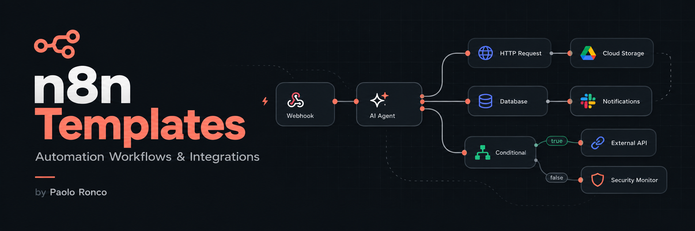

# n8n Templates — Paolo Ronco

A curated collection of n8n automation workflows, practical implementation guides and reusable assets. Templates are organized by solution, with variants and releases grouped together.

 

## Template catalog

All templates are free. Each folder contains the importable workflow JSON and its setup instructions.

- [AI & Content](#ai--content)
- [OrbitPage](#orbitpage)
- [Business & Productivity](#business--productivity)
- [Cloud & DevOps](#cloud--devops)
- [Data & Integrations](#data--integrations)

### AI & Content

| Template | Description | Folder | n8n Creators | Docs/Guide |
|---|---|---|---|---|
| Website AI Chatbot | Authenticated website RAG chatbot with OpenAI, Qdrant, Cohere reranking and structured JSON responses. | [Folder](./workflows/website-ai-chatbot/) | [View](https://n8n.io/workflows/20208-run-an-english-website-chatbot-with-openai-gpt-5-and-qdrant/) | [Guide](https://paoloronco.notion.site/Website-AI-Chatbot-404f0ba27c32807bad10d69e95ef3179?pvs=73) · [README](./workflows/website-ai-chatbot/README.md) |
| WordPress AI Chatbot | Index WordPress posts into Qdrant and answer visitors through a webhook chatbot with intent routing, small talk, Cohere-reranked RAG and privacy-preserving logging. Includes a WordPress plugin frontend. | [Folder](./workflows/wordpress-ai-chatbot/) | — | [Plugin guide](./workflows/wordpress-ai-chatbot/Frontend-wordpressPlugin&Website/wordpress-ai-chatbot-plugin/README.md) |
| WordPress VoiceOvers — Multilingual Google Cloud TTS | Automatically generate and publish multilingual WordPress voiceovers with Google Cloud TTS, translation, retry queue and change detection. | [Folder](./workflows/wordpress-ai-voiceovers/) | [View](https://n8n.io/workflows/11789-convert-wordpress-articles-to-multilingual-voiceovers-with-google-tts-and-openai/) | [Guide](./workflows/wordpress-ai-voiceovers/README.md) |
| AI News → Instagram Publishing | Generate social posts from RSS news and publish them to Instagram using AI and Cloudinary. | [Folder](./workflows/ai-instagram-publishing/) | [View](https://n8n.io/workflows/11791-automate-rss-to-instagram-with-ai-generated-content-and-cloudinary/) | [Guide](https://paoloronco.notion.site/Documentation-n8n-RSS-AI-Instagram-Publishing-3f5f0ba27c32806ba425f7d84c72961a?pvs=74) |
| Tech & AI News Digest | RSS collection, AI ranking, summaries and email delivery. | [Folder](./workflows/tech-ai-news-digest/) | — | [Guide](https://paoloronco.it/writing/n8n-template-rss-tech-news-to-your-inbox) |
| Second Brain v2 — Instagram Reel to Notion | Save public Instagram Reels as structured Notion knowledge using Telegram, Apify and OpenAI. Italian and English output variants available. | [Folder](./workflows/secondbrain/v2/) | [View](https://n8n.io/workflows/21770-save-instagram-reels-as-structured-notion-pages-with-telegram-apify-and-openai/) | [Guide](https://paoloronco.notion.site/Documentation-Instagram-Reel-to-Notion-Second-Brain-404f0ba27c3281e1b7e0cd5159fb6bc7?pvs=73) |
| Second Brain v3 — Telegram Multimodal to Notion | Capture Instagram, TikTok, webpages, screenshots and rough ideas from Telegram as concise English Notion notes and tasks. | [Folder](./workflows/secondbrain/v3/) | — | [Guide](https://paoloronco.notion.site/Telegram-Multimodal-to-Notion-Second-Brain-40af0ba27c3281a79305de5bb8005998) · [README](./workflows/secondbrain/v3/README.md) |
| Second Brain v4 — Telegram, OpenAI & Notion | Capture Instagram posts and Reels, TikTok, YouTube videos and Shorts, webpages, screenshots and ideas from Telegram as Notion notes with AI summaries and up to three grounded tasks. | [Folder](./workflows/secondbrain/v4/) | — | [Guide](./workflows/secondbrain/v4/README.md) |

Compare the Second Brain versions in the [Second Brain overview](./workflows/secondbrain/).

### OrbitPage

Browse the [OrbitPage workflow collection](./workflows/orbitpage/) for page editing, release checks, events, campaigns, analytics, YouTube publishing and Google Sheets menu sync.

| Template | Description | Folder | n8n Creators | Docs/Guide |
|---|---|---|---|---|
| OrbitPage AI Page Editor | Edit OrbitPage pages through AI chat, review validated previews and approve publication. | [Folder](./workflows/orbitpage/orbitpage-ai-page-editor/) | [View](https://n8n.io/workflows/21795-edit-and-publish-orbitpage-site-content-with-openai-chat-approval/) | [Guide](./workflows/orbitpage/orbitpage-ai-page-editor/README.md) |
| OrbitPage Release Guardian | Monitor website revisions, verify published pages, approve private drafts and request human-approved rollback after failed checks. | [Folder](./workflows/orbitpage/orbitpage-release-guardian/) | [View](https://n8n.io/workflows/21773-guard-orbitpage-releases-with-gmail-approvals-and-rollback-controls/) | [Guide](./workflows/orbitpage/orbitpage-release-guardian/README.md) |
| Update an OrbitPage Event Before, During and After | Publish approved event phases at one stable URL, with guarded revisions, a durable journal and a reusable local QR. | [Folder](./workflows/orbitpage/orbitpage-event-lifecycle/) | [View](https://n8n.io/workflows/22354-publish-phased-orbitpage-event-pages-with-email-approvals-and-data-tables/) | [Guide](./workflows/orbitpage/orbitpage-event-lifecycle/README.md) |
| Build an OrbitPage Campaign Page with Ad Copy, UTM Links and QR | Review one offer, publish its campaign subpage, verify the result and deliver matching ad copy, UTM links and a local QR. | [Folder](./workflows/orbitpage/orbitpage-campaign-launch-kit/) | [View](https://n8n.io/workflows/22355-publish-orbitpage-campaign-pages-with-email-approvals-and-qr-launch-kits/) | [Guide](./workflows/orbitpage/orbitpage-campaign-launch-kit/README.md) |
| Review OrbitPage Analytics and Approve One CTA Improvement | Send a measured analytics report and optionally review and publish one exact server-previewed CTA title improvement. | [Folder](./workflows/orbitpage/orbitpage-analytics-improvement/) | [View](https://n8n.io/workflows/22356-send-weekly-orbitpage-analytics-reports-and-review-one-ai-cta-change-via-email/) | [Guide](./workflows/orbitpage/orbitpage-analytics-improvement/README.md) |
| Add New YouTube Videos to OrbitPage | Add new YouTube videos as native players, automatically or after email approval. No YouTube API key. | [Folder](./workflows/orbitpage/add-new-youtube-videos-to-orbitpage/) | [View](https://n8n.io/workflows/22127-publish-new-youtube-videos-to-orbitpage-with-optional-email-approval/) | [Guide](./workflows/orbitpage/add-new-youtube-videos-to-orbitpage/README.md) |
| Sync Google Sheets Menus and Price Lists to OrbitPage | Sync approved sheet rows to a native menu section with previews, email review and preserved unrelated content. | [Folder](./workflows/orbitpage/sync-google-sheets-menus-and-price-lists-to-orbitpage/) | [View](https://n8n.io/workflows/22130-sync-approved-google-sheets-menu-items-with-orbitpage-native-menus/) | [Guide](./workflows/orbitpage/sync-google-sheets-menus-and-price-lists-to-orbitpage/README.md) |

### Business & Productivity

| Template | Description | Folder | n8n Creators | Docs/Guide |
|---|---|---|---|---|
| Invoice Archiving & Data Extraction | Gmail invoice processing and archiving. V3 adds Google Drive, a review queue and recovery. | [Folder](./workflows/invoice-archiving/) · [V1](./workflows/invoice-archiving/V1/) · [V2](./workflows/invoice-archiving/V2/) · [V3](./workflows/invoice-archiving/V3/) | [V1](https://n8n.io/workflows/10923-automatic-email-invoice-archiving-and-data-extraction-with-gmail-drive-and-ai/) | [V1](https://paoloronco.it/writing/n8n-template-automated-invoice-archiving) · [V2](./workflows/invoice-archiving/V2/README.md) · [V3](./workflows/invoice-archiving/V3/README.md) |
| Digital Certificate Creation & Validation | Create and validate digital certificates with an HTML/CSS PDF variant or a PDF Generator API variant. | [Folder](./workflows/digital-certificates/) · [HTML PDF](./workflows/digital-certificates/html-pdf/) · [PDF Generator API](./workflows/digital-certificates/pdf-generator-api/) | [View](https://n8n.io/workflows/11886-create-and-validate-digital-certificates-with-pdf-generator-api-and-gmail/) | [Article v1](https://paoloronco.it/writing/n8n-template-certification-creator-checker) · [Article v2](https://paoloronco.it/writing/n8n-template-certification-creator-checker-with-pdfgenerationapi-templates) |
| Newsletter & Release Announcements | Subscriber management, welcome emails and GitHub release announcements. | [Folder](./workflows/newsletter-automation/) | [View](https://n8n.io/workflows/20636-send-newsletter-welcomes-and-release-announcements-with-github-openai-and-smtp/) | [Guide](./workflows/newsletter-automation/README.md) |
| Menu Order Notifications | V1–V3 releases plus V4 staging: smart order alerts, TTS, BAC tracking, fallbacks and daily reports. | [Folder](./workflows/menu-order-notifications/) · [V1](./workflows/menu-order-notifications/V1/) · [V2](./workflows/menu-order-notifications/V2/) · [V3](./workflows/menu-order-notifications/V3/) · [V4 Staging](./workflows/menu-order-notifications/V4/) | [V3](https://n8n.io/workflows/14487-notify-on-menu-orders-via-ntfy-and-home-assistant-tts-with-daily-bac-tracking/) | [V1](https://paoloronco.notion.site/Documentation-Menu-Order-Push-Notifications-48bf0ba27c3282fcb5e50148e52fb8cd) · [V2](https://paoloronco.notion.site/Documentation-Menu-Order-Push-Notifications-Home-Assistant-TTS-849f0ba27c32836e844101b86f496c55) · [V3](https://paoloronco.notion.site/Documentation-Menu-Order-Push-Notifications-Home-Assistant-TTS-BAC-033f0ba27c3282719669018ae292091b) · [V4 Staging](./workflows/menu-order-notifications/V4/README.md) |

### Cloud & DevOps

| Template | Description | Folder | n8n Creators | Docs/Guide |
|---|---|---|---|---|
| Google Cloud Inventory & IAM Change Audit | v2.1.0 multiproject inventory, IAM findings and snapshot changes with central BigQuery history, a Google Sheets dashboard and optional email digests. | [Folder](./workflows/google-cloud-inventory/) · [V1](./workflows/google-cloud-inventory/V1/) · [V2](./workflows/google-cloud-inventory/V2/) | [View](https://n8n.io/workflows/22116-audit-google-cloud-inventory-and-iam-changes-with-bigquery-and-google-sheets/) | [Guide](https://paoloronco.notion.site/Google-Cloud-Inventory-Change-Audit-408f0ba27c3281aea226fecadfab05f8?pvs=73) · [Setup](https://paoloronco.notion.site/Setup-Configuration-408f0ba27c3281159afbf589df96e399) · [Sheets model](https://docs.google.com/spreadsheets/d/16uTQRgZSTN2GN2nE2giTPu2ZyfWONfvt5m5gkOIOgeY/copy) |
| Backup & Sync Execution Validation | Log-driven validation of scheduled backup/sync jobs. | [Folder](./workflows/backup-sync-monitoring/) | [View](https://n8n.io/workflows/12880-monitor-backup-and-sync-logs-with-google-cloud-storage-github-gmail-openai-and-glpi/) | [Guide](https://paoloronco.notion.site/Documentation-Reliable-Backup-Sync-Execution-Validation-Log-Driven-403f0ba27c3280179a84fb206e06481a?pvs=74) · [README](./workflows/backup-sync-monitoring/README.md) |
| Splunk Security Alert Notifications | Basic Splunk alert notifications (V1) and enriched, deduplicated alert routing via AbuseIPDB, email and Telegram (V2). | [Folder](./workflows/splunk-alert-notifications/) · [V1](./workflows/splunk-alert-notifications/v1/) · [V2](./workflows/splunk-alert-notifications/v2/) | [V2](https://n8n.io/workflows/19906-enrich-and-route-splunk-security-alerts-via-abuseipdb-email-and-telegram/) | [V1](./workflows/splunk-alert-notifications/v1/README.md) · [V2](./workflows/splunk-alert-notifications/v2/README.md) |

### Data & Integrations

| Template | Description | Folder | n8n Creators | Docs/Guide |
|---|---|---|---|---|
| Amazon Luna Prime Games | Synchronize included-with-Prime games with Google Sheets. | [Folder](./workflows/amazon-luna-prime-games/) | [View](https://n8n.io/workflows/10733-sync-amazon-luna-prime-games-to-google-sheets-with-automatic-updates/) | [Guide](https://paoloronco.it/writing/amazon-luna-fetch-included-with-prime-games) |
| Template Publishing Assistant | Upload an exported n8n workflow to redact secrets, generate documentation, Notion pages, cover and thumbnail images, and email a ready-to-publish package. | [Folder](./workflows/template-publishing-assistant/) | — | [Guide](./workflows/template-publishing-assistant/README.md) |

## Importing a workflow

1. Open the relevant template folder and read its README.
2. Download the workflow JSON from the folder.
3. Import the JSON into n8n and configure credentials, endpoints and environment-specific values.
4. Test manually before activating production triggers.

## Professional services

Need help implementing or adapting these workflows to your environment? For consulting and implementation inquiries, contact [info@paoloronco.it](mailto:info@paoloronco.it) or visit [paoloronco.it](https://paoloronco.it).

## Resources

- [n8n Creator profile](https://n8n.io/creators/paoloronco/)
- [n8n guides](https://paoloronco.it/portfolio/n8n-guides/)
- [n8n documentation](https://docs.n8n.io/)

Maintained by [Paolo Ronco](https://paoloronco.it).
