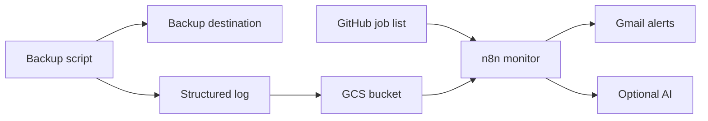

# Complete Setup Guide

This is the **main document**. Follow the steps in order to monitor a backup running on your Linux machine.

## How it works
Your backup can go to Hetzner, a NAS, OneDrive, Google Drive, S3 or another server. Only its **execution log** goes to Google Cloud Storage (GCS), where n8n checks it against the GitHub job manifest.



## Requirements
Linux with Bash, rsync/rclone and cron; access to your backup destination; private GCS bucket; GitHub repository; n8n with GCS/GitHub/Gmail credentials. OpenAI credentials for the AI branch.

## Step 1 — Generate a structured log
Use [rsync](scripts/rsync_job-Template.sh) or [rclone](scripts/rclone_job-Template.sh). Configure `JOB`, `SRC`, `DST`, `LOGDIR` and SSH settings where needed.

```bash
JOB=Documents SRC=/srv/documents/ DST=backup@example.org:/backups/documents/ LOGDIR=/var/log/sync-jobs bash scripts/rsync_job-Template.sh
tail -n 12 /var/log/sync-jobs/OracleCloud_Documents-rsync.log
```

Check `START`, `RSYNC_END`/`RCLONE_END`, `SUMMARY`, `END` and final `rc=0` on success. [More details](docs/02-backup-scripts.md).

## Step 2 — Upload completed logs to GCS
Create a private bucket and configure an rclone remote named `gcs` using `rclone config`.

```bash
BUCKET=YOUR_GCS_LOG_BUCKET HOST=YOUR_HOSTNAME LOGDIR=/var/log/sync-jobs bash scripts/upload-logs-to-gcs.sh
```

Expected object: `sync-logs/YOUR_HOSTNAME/YYYY/MM/DD/OracleCloud_Documents-rsync.log`. [GCS instructions](docs/03-gcs-upload.md).

## Step 3 — Define expected logs in GitHub
Copy [sync-jobs.example.json](config/sync-jobs.example.json) to `/sync-jobs.json` in your GitHub repository. Match the `log_file` exactly to the uploaded filename. [Manifest guide](docs/04-github-manifest.md).

## Step 4 — Import and configure n8n
Import [Backup_Sync_V2.json](workflow/Backup_Sync_V2.json). Set hostname, **both** GCS bucket fields, GitHub owner/repo, Gmail recipients and credentials. Review timezone and upload cutoff. [Node-by-node setup](docs/05-n8n-setup.md).

## Step 5 — Test
Test one successful log, one missing expected log, one synthetic failed log and multiple logs together. [Test plan](docs/07-testing.md).

## Step 6 — Schedule
**Backup finishes → upload finishes → n8n runs.** The V2 trigger is 09:30 and the default presence-check upload cutoff is 08:10 Europe/Rome; GCS prefix date is UTC. Adjust to your actual schedule.

## What is checked?
| Stage | Purpose |
| --- | --- |
| GCS listing | Detect missing expected log files |
| Deterministic parsing | Detect missing markers, nonzero rc, errors and warnings |
| Optional AI | Additional anomalies in log text |
| Gmail | Send missing-log, execution-error and AI-finding alerts |

[Architecture](docs/01-architecture.md) · [Alerts & AI](docs/06-alerts-ai.md) · [Other cloud providers](docs/08-cloud-providers.md)

**Validation status:** Importable sanitized V2; no live end-to-end integration test has been performed. [Release notes](docs/09-release-notes.md).
