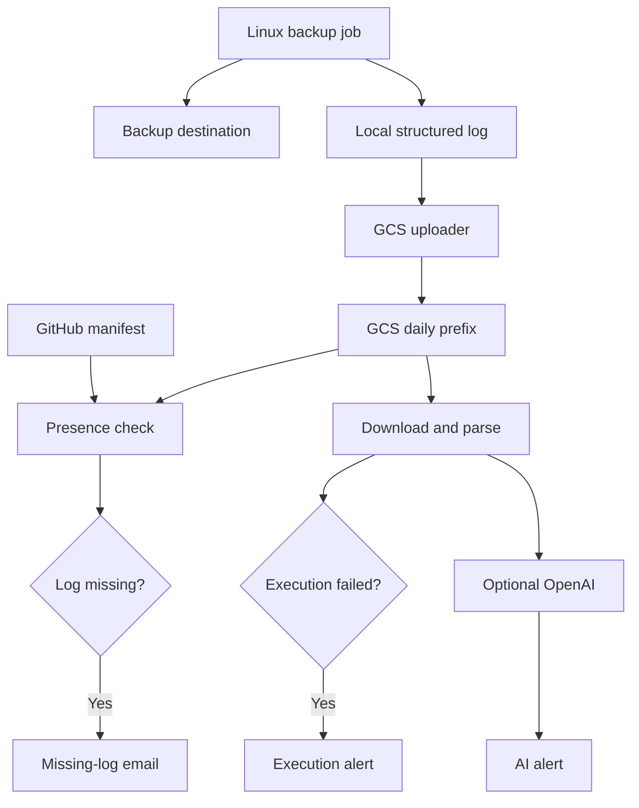

# 01 — Architecture & Monitoring

[← Main guide](../GUIDE.md) · [Next →](02-backup-scripts.md)

The backup runs **outside n8n**. Its script writes a structured log, uploaded to GCS. GitHub defines expected filenames; n8n checks presence and execution status.

| Component | Role |
| --- | --- |
| Backup script | Runs the backup and records outcome |
| GCS | Stores dated logs, not necessarily backup data |
| GitHub | Lists expected jobs and log filenames |
| Presence check | Detects absent expected log files |
| Parser | Checks lifecycle markers, return code, errors and warnings |
| AI | Reviews log text for additional anomalies |
| Gmail | Sends alerts |
