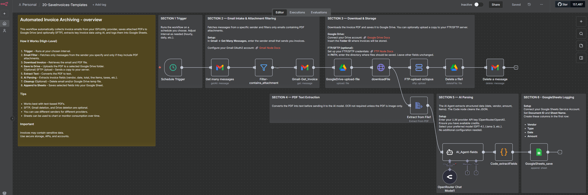

# Invoice Archiving — n8n Templates

Two versions of the invoice archiving workflow are available. Choose the one that fits your environment.

## Versions

| Version | Workflow | Description |
| --- | --- | --- |
| [V1](./V1/) | Automated Invoice Archiving and AI Data Extraction | Gmail → Google Drive / optional SFTP → AI extraction (OpenRouter) → Google Sheets. Original published template. |
| [V2](./V2/) | Unified Invoice Archiving | Gmail → provider-specific PDF parsing and validation → SFTP → Google Sheets. Supports Octopus Energy, Dimensione, Google Cloud, and Hetzner without an LLM. |

Each version includes an importable n8n JSON file and its own setup instructions.

## Links

- **n8n Creator (V1):** [Original template](https://n8n.io/workflows/10923-automatic-email-invoice-archiving-and-data-extraction-with-gmail-drive-and-ai/)
- **Gumroad (V1):** [Automated Invoice Archiving](https://paoloronco.gumroad.com/l/invoice-archiving)
- **YouTube (V1):** [Workflow walkthrough](https://youtu.be/0s-95L8cmyE)
- **Setup article (V1):** [paoloronco.it](https://paoloronco.it/n8n-template-automated-invoice-archiving/)

> **Note:** V2 is a separate revision, not the version currently linked from the n8n Creator, Gumroad, or YouTube resources above. Configure credentials, Gmail senders, SFTP paths, and Google Sheets IDs before use. Test manually before activating the schedule.

