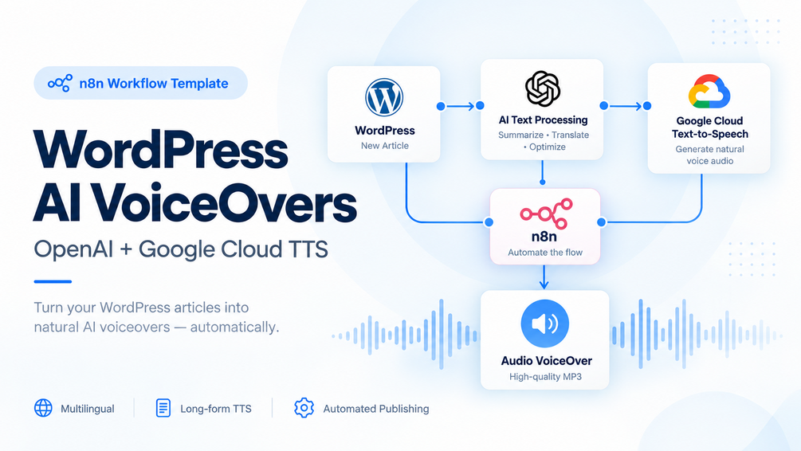

# WordPress VoiceOvers v1.3 — Google Cloud TTS

Turns recent WordPress articles into Italian and English WAV voiceovers. n8n uses Google Sheets as a queue, Google Translate for English, a supplied Cloud Run service for long-form TTS, and two WordPress pages as audio indexes.

## What v1.3 fixes

- Waits for Google Long Audio Synthesis to complete before publishing a player.
- Writes done only after both language branches complete.
- Uses Post ID markers so WordPress retries do not append duplicate players.
- Preserves commands, URLs, paths and punctuation; OpenAI is no longer required.
- Sends JSON bodies as objects and records handled processing failures in Sheets.
- Requires an API key at the Cloud Run application boundary and documents IAM/OIDC as the stronger deployment option.
- Reads and writes raw WordPress page content to preserve blocks and shortcodes.

## Package

- Workflow: Workflow/WordPress_VoiceOvers_withAI_GoogleCloud_updated.json
- Service: GoogleCloud-Code/main.py and Dockerfile
- Configuration example: GoogleCloud-Code/.env.example
- Service tests: GoogleCloud-Code/test_main.py
- Setup and operations guide: Docs-Notion/

The workflow imports inactive. Replace every placeholder and run one manual test before activation.

## Requirements

n8n, WordPress REST access, a six-column Google Sheet, and a billed Google Cloud project with Cloud Run, Text-to-Speech, Translate, Storage, Build and Artifact Registry APIs. OpenAI is not used.

## Links

- [n8n Creator](https://n8n.io/workflows/11789-convert-wordpress-articles-to-multilingual-voiceovers-with-google-tts-and-openai/)
- [Gumroad](https://paoloronco.gumroad.com/l/ailfum)
- [Store](https://shop.paoloronco.it/21-n8n-workflow-wordpress-ai-voiceovers-with-google-cloud.html)

See 00 Home.md for the supported installation path.
