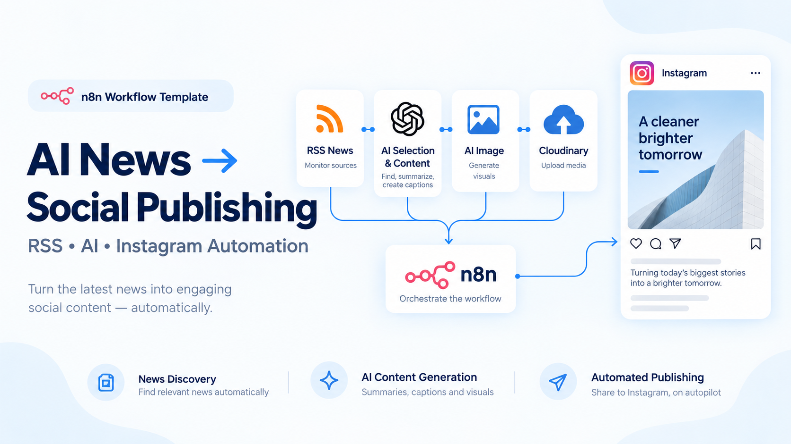

# RSS to Instagram with AI

Turn RSS stories into an Instagram post with AI-written copy and a generated image. OpenAI selects up to three articles, writes the caption and image headline, and creates the visual. The workflow adds text overlays, hosts the image on Cloudinary and publishes through the Meta Graph API.

## Download and documentation

- [Download the workflow JSON](https://github.com/paoloronco/n8n-templates/raw/refs/heads/main/workflows/ai-instagram-publishing/RSS_AInews-socialPublishing_template.json)
- [Browse the workflow file](./RSS_AInews-socialPublishing_template.json)
- [Read the complete setup documentation](https://paoloronco.notion.site/3f5f0ba27c32806ba425f7d84c72961a)
- [Get the template on Gumroad](https://paoloronco.gumroad.com/l/AInews-SocialPubblishing)

The revision of n8n Creator submission **#11791** has been submitted for review. Publication in the n8n template library depends on that review.

## How it works

1. **Collect stories.** Read the configured RSS feed, combine its titles, previews and links, and assign article IDs.
2. **Select the source material.** An OpenAI agent chooses up to three article IDs. Code nodes match them to the original feed entries and pass the selected URLs to the writer.
3. **Write the post.** Generate one Instagram caption and a short image headline. Gmail sends a copy of the caption to the configured recipient.
4. **Create the visual.** Generate an image, apply a blur, and add the headline and “Read more below” overlays.
5. **Host the image.** Upload the file to Google Drive and use Cloudinary to provide the public media URL. A separate delayed branch removes the temporary Drive file.
6. **Publish to Instagram.** Create a media container, check its processing status, wait when necessary, publish when ready, and query the result.

The email is a notification: sending it does not pause the publishing branch for approval.

## Requirements

- An n8n environment that supports the included nodes and image operations.
- The `n8n-nodes-cloudinary` community package installed in that environment.
- OpenAI API access for the selected text models and image generation.
- Gmail and Google Drive credentials, plus a designated temporary Drive folder.
- A Cloudinary account and credentials for the upload node.
- An Instagram Professional account and Meta credentials with publishing access.

The JSON imports without account credentials. Select your own credentials in every service node and review the model choices for your OpenAI account.

## Setup

1. Download the JSON above and import it into n8n. Keep the workflow inactive while configuring it.
2. Install the Cloudinary community package if it is not already available. Confirm that the image-editing nodes are supported by your n8n deployment.
3. Connect OpenAI, Gmail, Google Drive, Cloudinary and Meta credentials in their respective nodes.
4. Replace the account-specific values:

   | Node | What to configure |
   | --- | --- |
   | `RSS Read` | Feed URL for the stories you want to cover |
   | `Send Content Confirmation1` | Replace `your-email@example.com` with the notification recipient |
   | `Upload file` | Replace `YOUR_GOOGLE_DRIVE_FOLDER_ID` with your temporary folder ID |
   | `Upload an asset from URL` | Cloudinary account and source URL/input mapping; verify that the returned URL is publicly accessible |
   | `Instagram params` | Replace `YOUR_INSTAGRAM_BUSINESS_ACCOUNT_ID`; review the image URL, caption and hashtags |
   | OpenAI nodes | Available text models, image settings and credentials |
   | Meta Graph API nodes | Target account, permissions and a consistent supported API version |

5. Align the selection, writing, headline and image prompts with your topic. The example feed and several prompts focus on cybersecurity; the selection prompt also refers to AI and automation.
6. Adjust the image text, colors, font size and placement for the generated image dimensions. Review the temporary-file cleanup delay.
7. Run a controlled manual test. Check article selection, caption, notification email, image, Cloudinary URL and Meta publishing result. A configured run can send email and publish a live Instagram post.
8. Set the schedule and time zone, then activate the workflow when your test succeeds.

## Customize

- **Editorial focus:** change the feed, selection criteria, writing style and hashtags together.
- **Branding:** adapt the image prompt, blur, headline placement and call to action.
- **Review process:** add an explicit approval step before the Meta publishing branch if human review is required.
- **Cadence:** change the schedule to match your publication frequency.
- **Distribution:** extend the workflow with separate publishing branches for other channels.

## Operating notes

- The writer receives the selected URLs. This export has no separate step that downloads and verifies the full article text; review generated facts against the sources.
- Repeated feed items are not tracked in a persistent publication history. Add deduplication if your schedule must avoid covering the same story again.
- Review the media-status wait loop and its failure handling for your environment before unattended operation.
- Downloads on Gumroad point to this GitHub folder. Downloading a newer JSON does not update an existing n8n installation automatically.
- OpenAI, Cloudinary and other services may charge separately for usage.

## Support

For setup or customization help, [contact Paolo Ronco](mailto:info@paoloronco.it) or visit [paoloronco.it](https://paoloronco.it/).
