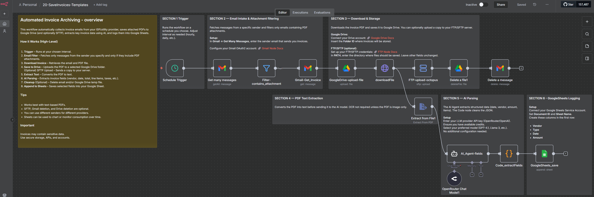

# Invoice Archiving — n8n Templates

Three versions of the invoice archiving workflow are available. Choose the one that fits your environment.

## Versions

| Version | Workflow | Description |
| --- | --- | --- |
| [V1](./V1/) | Automated Invoice Archiving and AI Data Extraction | Gmail → Google Drive / optional SFTP → AI extraction (OpenRouter) → Google Sheets. Original published template. |
| [V2](./V2/) | Unified Invoice Archiving | Gmail → configurable provider profiles → deterministic PDF extraction → SFTP → Google Sheets. No AI required. |\n| [V3](./V3/) | Invoice Processing & Archiving | Gmail → PDF validation and categorization → duplicate/recovery checks → organized Google Drive storage + Google Sheets. Review Queue, optional OCR/AI, labels and reporting. **Test required; not yet submitted to n8n Creators.** |

Each version includes an importable n8n JSON file and its own setup instructions.

## Links

- **n8n Creator (V1):** [Original template](https://n8n.io/workflows/10923-automatic-email-invoice-archiving-and-data-extraction-with-gmail-drive-and-ai/)
- **Gumroad (V1):** [Automated Invoice Archiving](https://paoloronco.gumroad.com/l/invoice-archiving)
- **YouTube (V1):** [Workflow walkthrough](https://youtu.be/0s-95L8cmyE)
- **Setup article (V1):** [paoloronco.it](https://paoloronco.it/n8n-template-automated-invoice-archiving/)

> **Distribution status:** The n8n Creator, Gumroad and YouTube links above refer to **V1**. **V2** is available separately on [Gumroad](https://paoloronco.gumroad.com/l/invoice-archivingtracking) and GitHub. **V3** is available here on GitHub but has **not** been submitted to n8n Creators; it requires authenticated end-to-end testing before use.\n\n## What's new in V3?\n\n- **Google Drive replaces SFTP** for broader accessibility, with a planned year/month/category hierarchy.\n- **One invoice registry** in Google Sheets plus a separate **Review Queue** for invalid documents.\n- **Preventive duplicate checks** and Drive recovery logic intended to reduce repeated uploads after partial failures.\n- **More invoice fields**, including an optional payment due date, classification and configurable validation.\n- **Optional OCR and AI fallback**, Gmail processed/review labels and execution summary emails.\n- **Cleaner n8n Creator canvas** with concise notes and organized sections.\n\n**Important:** V3's Drive lookup/folder parameters, recovery and summary aggregation still need end-to-end verification. OCR/AI endpoints are optional stubs requiring configuration. See the [V3 README](./V3/README.md) before enabling the schedule.

