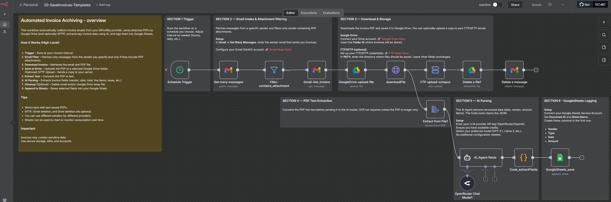

# Invoice Archiving — n8n Templates

The invoice workflows have separate version histories and destinations.

| Version | Workflow | Scope |
| --- | --- | --- |
| [V1](./V1/) | Automated Invoice Archiving and AI Data Extraction | Original published n8n Creator template. Gmail, Google Drive/optional SFTP, AI extraction and Google Sheets. Preserved unchanged. |
| [V2](./V2/) | Unified Invoice Archiving | GitHub version using Gmail, configurable rules, SFTP and Google Sheets. No AI required. |
| [V2.1](./V2.1/) | Invoice archiving with duplicate checks and review queue | New standalone SFTP template with fictional provider profiles, preventive Sheets/SFTP checks, review logging and per-message Gmail Trash safeguards. |
| [V3](./V3/) | Invoice Processing & Archiving | Gmail, PDF validation, Google Drive folders, duplicate/recovery checks and Google Sheets with a Review Queue. Optional OCR/AI, Gmail labels and completion reports. Prepared for the revised Creator submission; final submission is manual. |

V4 beta is not included in this release. Each published GitHub version contains an importable JSON and setup instructions. V3 still requires testing with your own credentials and invoice samples before unattended use.

## Original V1 links

- **n8n Creator:** [Original template](https://n8n.io/workflows/10923-automatic-email-invoice-archiving-and-data-extraction-with-gmail-drive-and-ai/)
- **Gumroad:** [Automated Invoice Archiving](https://paoloronco.gumroad.com/l/invoice-archiving)
- **YouTube:** [Workflow walkthrough](https://youtu.be/0s-95L8cmyE)
- **Setup article:** [paoloronco.it](https://paoloronco.it/writing/n8n-template-automated-invoice-archiving)

## V3 behavior

V3 uses Drive in place of V2's SFTP destination. It resolves exact year/month/category folders beneath the configured parent, preserves rules-based or AI-validated records through the duplicate lookup, recovers existing PDFs by canonical filename and collects terminal outcomes for the optional summary. Invalid documents enter the Review Queue.

OCR and AI are opt-in HTTP integrations requiring endpoint-specific configuration and authentication. Local simulated regression tests do not replace live account testing. See the [V3 setup guide](./V3/README.md) before activating the schedule.

