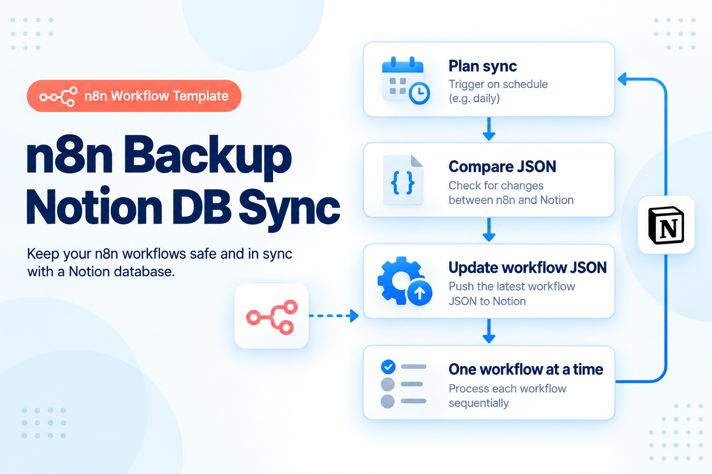

# n8n Workflow Backup to Notion · V4

## n8n publication and source versions

- [n8n #23213 — V3](https://n8n.io/workflows/23213-back-up-workflow-catalog-json-to-notion-with-n8n-api/): V3: 32 nodes plus the 12-node setup companion (10 operational, 2 notes) from repository history. Unified V4: 30 nodes, submission #22936 under review. [Published release reference](https://github.com/paoloronco/n8n-templates/tree/main/catalog/n8n-published/23213).
- The main `workflow.json` is the exact V4 review candidate for [#22936](https://creators.n8n.io/workflows/22936), not the published V3.

Back up saved n8n workflows into a structured Notion catalog. One workflow creates or reuses the catalog, generates documentation from sticky notes, attaches a complete JSON export and verifies the downloaded file. Existing pages, personal notes and unchanged attachments are reused.

The unified revision replaces V3's separate setup companion. Import only **workflow.json**.

[Download workflow JSON](https://github.com/paoloronco/n8n-templates/raw/refs/heads/main/workflows/n8n-notion-workflow-backup/workflow.json) · [Validation](VALIDATION.md) · [Changes](CHANGELOG.md)

The legacy `setup-notion-catalog.json` file remains for existing V3 download links. V4 does not call or require it. The complete two-file V3 package is available in the [repository history](https://github.com/paoloronco/n8n-templates/tree/3cf0e9a9fa2e9d572ff3f8030aa6db3d7795ecf8/workflows/n8n-notion-workflow-backup).

## How it works

1. Create or adopt a catalog through the same paced API loop used by the backup.
2. Read active, inactive and archived workflows visible to the n8n API account, following pagination and configured exclusions.
3. Match each source ID to one stable Notion page. Keep the previous export when a source becomes unavailable.
4. Generate a five-section guide and an appendix containing the original sticky-note text. Protect recognized personal edits and the Notes property.
5. Upload one formatted JSON attachment and download it to verify its identity, bytes and hash before retiring a previous managed copy.
6. Reuse recent checks for unchanged sources, with periodic full verification. Update documentation blocks in place where possible and verify insertions by reading them back.

Supported published webhook, form, chat and messaging endpoints are documented from the published source graph during the same source read. Draft routes are not treated as live endpoints. No second ingress inventory pass or companion workflow is required.

## Setup

1. Import **workflow.json** and keep it inactive while configuring it.
2. Select an n8n API credential in **n8n API · read only**. It needs workflow list/read and execution list permissions; the backup does not modify or execute source workflows.
3. Select the same Notion integration credential in **Notion API · snapshots & audit** and **Upload complete JSON file**. Share the intended parent page or existing catalog with that integration.
4. Edit **Configuration**. Set `n8nOrigin` and `n8nApiBase`, then either a shared `notionParentPageId` or an existing `documentationDataSourceId`.
5. Leave the data source empty to create a dedicated child page, inline database, 17 typed properties and a restore guide. Keep a stable `catalogTitle`; subsequent runs reuse it. Run initial setup sequentially for a parent/title combination.
6. Use `propertyNames` to adopt existing column names. For example, map `Name` to `Workflow`, `Workflow link` to `Apri n8n` and `Updated at` to `Last updated on`. Supported aliases are Name, Workflow link, Updated at, Webhook URLs, HTTP methods and Authentication. Keep ID, Status, Trigger, Notes and export-property names unchanged. Existing types must match; personal fields remain untouched.
7. Set `operation` to `setup` for a manual catalog-only run, or `backup` for a manual backup. Scheduled executions always back up. No setup workflow ID is needed.
8. Run manually, inspect the report and a Notion page, then repeat the run to check reuse. Configure binary storage, retention, time zone and schedule before publishing the configured workflow in your instance.

Email is optional. Enable its notification flags only after configuring the SMTP node and sender/recipient fields. If an independent n8n error workflow is used, select it in workflow settings before enabling `externalErrorHandler`.

## Catalog properties

| Property | Type | Purpose |
| --- | --- | --- |
| Name | Title | Source workflow name |
| ID | Text | Stable source identity |
| Status | Select | Active, inactive, scheduled, archived or unavailable |
| Trigger | Multi-select | Invocation types |
| Workflow link | URL | Open the source in n8n |
| Updated at | Date | Source modification time |
| Notes | Text | Personal notes, preserved |
| Node count | Number | Nodes excluding sticky notes |
| Tags | Multi-select | Source tags |
| Active | Checkbox | Source activation state |
| Archived | Checkbox | Source archive state |
| JSON bytes | Number | Verified export size |
| JSON SHA-256 | Text | Verified export hash |
| Backup saved at | Date | Accepted export timestamp |
| Webhook URLs | Text | Supported published endpoints |
| HTTP methods | Text | Published endpoint methods |
| Authentication | Text | Authentication mode, without secret values |

For the primary view, show the name, status, trigger, source link, update time and Notes. Technical properties can be hidden. Existing catalog views and unrelated properties are preserved.

## Customization

- Adjust the schedule and time zone, source inclusion/exclusions, file allowance and runtime budget.
- Keep `includeInactive` true. Names beginning `Temporary -` are excluded as maintenance workflows.
- Keep Notion pacing at least 0.35 seconds; increase it when the workspace needs lower request pressure.
- Use `forceFullVerification` for an immediate attachment audit. Successful production executions persist the cache; editor runs may repeat checks.
- Improve source sticky notes to improve generated documentation. Keep personal writing in Notes or outside managed sections.

## Requirements and restore

Use an n8n deployment with suitable binary storage and sufficient retention/capacity, and a Notion account whose upload allowance covers the exports. The default file allowance is 5 MiB; files exceeding the configured or supported single-part limit fail while the previous backup is retained. No AI service or community node is required.

Exports contain the latest saved definition, which can differ from the published version. Operational backups can retain resource IDs, URLs and credential references. Recognized secret literals are redacted, but arbitrary confidential content in custom code is not guaranteed to be detected. Review operational exports before sharing them.

To restore, download the JSON and import it into a separate inactive workflow. Reconnect credentials and review redacted values, external resources, schedules and webhooks before activation. The n8n database, encrypted credentials, encryption key, pinned data and external runtime files require separate backups.
