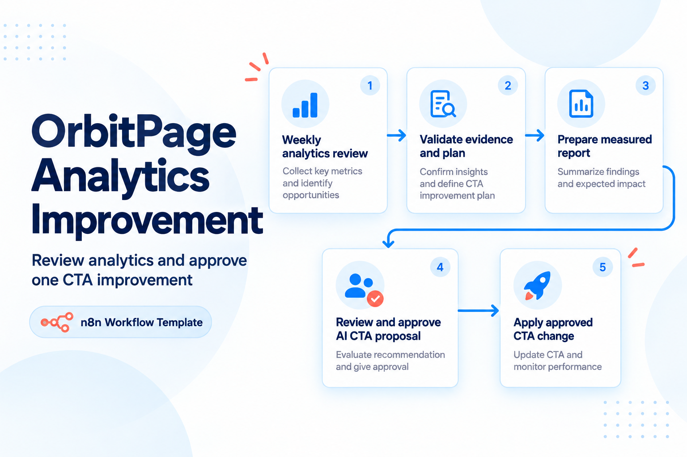
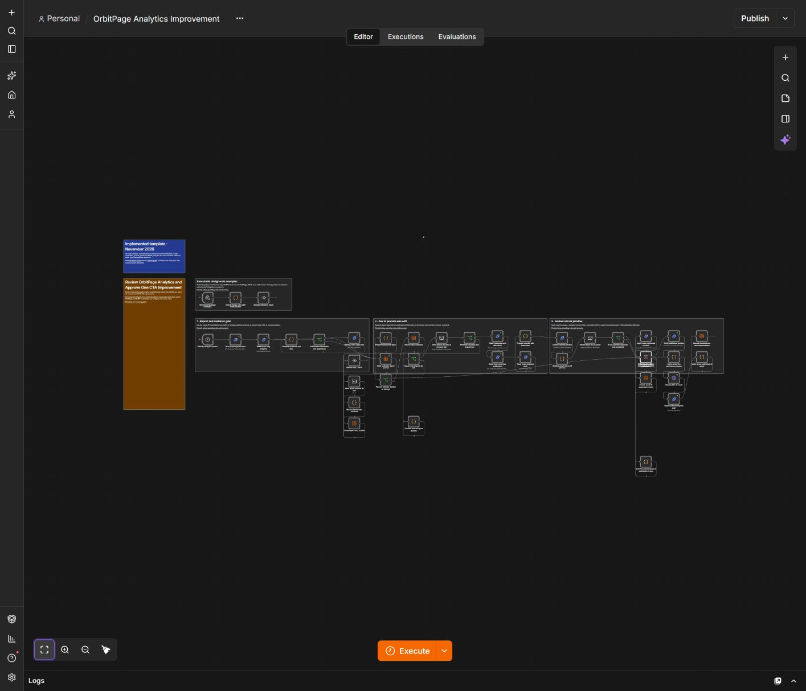

# Review OrbitPage Analytics and Approve One CTA Improvement

Send a measured analytics report and optionally review and publish one exact server-previewed CTA title improvement.

## How it works

Every Monday at 09:00 Europe/Rome, read publication, the actual seven-day analytics response and the full draft. Prepare one report with current/previous visits and clicks. With missing/basic analytics, fewer than 100 visits in either window, ambiguous root CTA attribution or unpublished changes, send a report without proposing an edit. Otherwise request permission to prepare one preview. This first approval does not publish.

After approval, re-read allowance, draft and publication. Request one server AI preview and validate that it changes exactly one selected root CTA title: same block id, destination, count, order, profile and theme. A second email asks approval for this exact preview, with an eight-minute wait and the server's expiry checked again. Commit that token once with publication enabled, then verify the public snapshot and complete draft before recording the result.

## Evidence and review rules

The floor of 100 visits in both periods is an operational threshold, not statistical significance. Clicks per 100 visits are not a conversion rate. The template does not promise uplift or attribute causality. Only existing root link/CTA titles are eligible; it does not rewrite subpages, destinations, prices, products or unrelated blocks. An unavailable/invalid AI preview stops without publication. AI preview may consume the workspace allowance.

Reports are deduplicated by UTC date and actual API period. A repeated same-day run produces no second report. Rejected or expired proposals are recorded; wait for a new report window. The journal retains at most 100 reports and needs deliberate archival. Never put preview tokens into email, public output or journal snapshots.

## First run

Run the setup companion, configure tables/credentials/email and execute the weekly trigger manually. Confirm the real report and SMTP acceptance. With sufficient real analytics, approve preparation, inspect the returned title diff and approve the exact server preview while it remains valid. Check that the title alone changed. On low traffic, a report-only result is expected.

## Workflow canvas

## Requirements and setup

1. Use an n8n installation supporting native Data Tables, Form Trigger, SMTP send-and-wait and the **n8n-nodes-orbitpage** community package. This release was verified with **n8n 2.43.6** and package **0.3.6**. Follow the [OrbitPage package installation guide](https://github.com/paoloronco/n8n-nodes-orbitpage/blob/main/docs/guides/getting-started.md). Community package installation must be available on your n8n plan.
2. Connect an OrbitPage workspace with the required features and a token scoped to **workspace:read, publication:read, publication:write, analytics:read, ai:write**. Confirm your plan exposes subpages or detailed analytics/AI as applicable. The public HTTPS page must be reachable from n8n.
3. Import **setup-journal.json**. For each additional imported instance, first give its Create-table node a distinct table name. Run it once to create six string columns and exactly one control row. A second run stops rather than resetting history. Record the resulting table id.
4. Import **workflow.json**. Select that table in **every** Data Table row node listed below. Do not share a journal between templates or workspace credentials. Keep the single control row; do not manually duplicate it.
5. Select your OrbitPage credential on every OrbitPage node and your SMTP credential on every Send Email node. Replace all **REPLACE_WITH_SENDER_EMAIL** and **REPLACE_WITH_OWNER_EMAIL** values with your verified sender and one owner inbox.
6. Protect intake forms for the owner and ensure n8n's approval resume URLs are reachable through your normal authenticated deployment. For self-hosted n8n, configure its externally reachable webhook URL and test an actual approval email. Avoid production customers while checking your setup.
7. Run the relevant first-run checks, then activate the appropriate production triggers. The imported workflow starts inactive while **all individual nodes are enabled**. Success/error execution data is not retained by default; maintain private diagnostics appropriate for your environment.

### Select the same journal in these nodes

- Record report identity
- Record outcome and next measurement
- Read analytics report journal
- Persist exact AI publication intent
- Store report-only journal

## Concurrency and recovery

Use one writer at a time per OrbitPage workspace. Revision/ETag checks reject concurrent changes rather than overwrite them. The native control row uses conditional updates plus exact execution-owner/record verification; it is not a general-purpose distributed locking service. Other workflows and dashboard edits may cause a conflict requiring fresh review.

Normal reads may retry. Mutating operations, AI requests/commits and SMTP delivery do not automatically retry. A pending/review journal protects against uncertain provider outcomes. A failed execution can deliberately leave this journal busy.

Before retrying, inspect the control row's state/snapshot and the failed node privately. Compare current publication and the full draft with the saved baseline and intended revision. Never simply clear pending state or republish an unknown outcome. A normal rerun only reconciles an already-public exact intended result after read-back verification. If the private draft or content has changed, stop, reconcile it in OrbitPage and request a new review. Expired review locks may require supervised release after verifying that no mutation occurred. Back up the row before any manual correction.

Campaign publication is recorded before email. If sending fails or acceptance is unknown, verify publication and SMTP logs, then resend the saved files manually if required. Replaying the same brief will not automatically send a duplicate. A 250 SMTP acceptance means the sending server accepted the message; it does not prove inbox delivery.

Journal snapshots may contain private business content. Keep them in your n8n project. Do not publish previews, logs, credential references or populated journals with a shared template.

## Files and validation

- **workflow.json** — executable import, without credentials or instance identifiers.
- **setup-journal.json** — native one-time journal creation.
- **README.md** — setup, examples, operation and recovery.
- **VALIDATION.md** — actual acceptance scope and boundaries.
- **cover.png / thumbnail.png** — original design-edition artwork, reused.

See [validation](./VALIDATION.md) and the [dependency-free checks](../tests/README.md). No ad spend, purchase or paid third-party QR service is required by this template. Your n8n, SMTP, OrbitPage plan and any AI allowance are separate services.

[More OrbitPage templates](../README.md)
