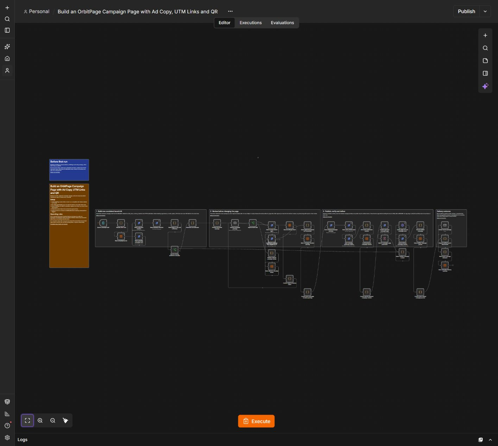

# Build an OrbitPage Campaign Page with Ad Copy, UTM Links and QR

Review one offer, publish its campaign subpage, verify the result and deliver matching ad copy, UTM links and a local QR.

## How it works

An owner submits one closed-schema brief. The workflow validates the offer facts, reads the complete baseline and builds native page blocks, matching ad draft/caption, UTM destinations and a local SVG QR. Email approval covers the exact package and expires after 24 hours. It then re-reads the revision and full draft, saves the merged collection privately, verifies all sections, binds publication to that revision, verifies the public page and only then emails the launch files.

## Input and delivery

Paste [example-input.json](./example-input.json) into the **campaign_brief** form field. Replace all example facts and HTTPS destinations. priceMinor is a non-negative integer in cents; currency is EUR, USD or GBP. endsAt requires an explicit UTC offset. Use an unchanged id and slug with a larger version to update an owned campaign. A separate id/slug represents another campaign. The journal allows at most 100 recorded requests; archive completed history deliberately rather than truncating pending intent.

The email contains **campaign-launch-kit.json**, **campaign-qr.svg** and **README.txt**. Canonical price/deadline facts are reused in the page and copy. The ad link uses utm_source=social / utm_medium=paid_social; the offline QR uses utm_source=qr / utm_medium=offline. Existing URL queries and fragments are retained. Ad copy remains a draft: the workflow does not buy ads or publish to an advertising account.

## First run

Run the setup companion, configure tables/credentials/email, submit a test brief and approve the exact package. Verify price, deadline, CTA, subpage content and delivered files. Replay the identical brief to confirm it produces no second publication or delivery. Reject a new request to confirm no page is published. Rejected/expired requests remain recorded; use a new reviewed version for a retry.

The import contains only the operational paths. Development examples are kept in the repository checks, outside the production canvas.

## Workflow canvas

## Requirements and setup

1. Use an n8n installation supporting native Data Tables, Form Trigger, SMTP send-and-wait and the **n8n-nodes-orbitpage** community package. This release was verified with **n8n 2.43.6** and package **0.3.6**. Follow the [OrbitPage package installation guide](https://github.com/paoloronco/n8n-nodes-orbitpage/blob/main/docs/guides/getting-started.md). Community package installation must be available on your n8n plan.
2. Connect an OrbitPage workspace with the required features and a token scoped to **workspace:read, publication:read, publication:write, pages:read, pages:write**. Confirm your plan exposes subpages or detailed analytics/AI as applicable. The public HTTPS page must be reachable from n8n.
3. Import **setup-journal.json**. For each additional imported instance, first give its Create-table node a distinct table name. Run it once to create six string columns and exactly one control row. A second run stops rather than resetting history. Record the resulting table id.
4. Import **workflow.json**. Select that table in **every** Data Table row node listed below. Do not share a journal between templates or workspace credentials. Keep the single control row; do not manually duplicate it.
5. Select your OrbitPage credential on every OrbitPage node and your SMTP credential on every Send Email node. Replace all **REPLACE_WITH_SENDER_EMAIL** and **REPLACE_WITH_OWNER_EMAIL** values with your verified sender and one owner inbox.
6. Protect intake forms for the owner and ensure n8n's approval resume URLs are reachable through your normal authenticated deployment. For self-hosted n8n, configure its externally reachable webhook URL and test an actual approval email. Avoid production customers while checking your setup.
7. Run the relevant first-run checks, then activate the appropriate production triggers. The imported workflow starts inactive while **all individual nodes are enabled**. Successful executions are not retained by default. Failed executions are retained privately for troubleshooting and journal recovery; configure n8n pruning/retention for your environment.

### Select the same journal in these nodes

- Reserve delivery intent
- Read campaign journal
- Mark campaign mutation pending
- Persist prepared campaign revision
- Store verified campaign journal
- Store campaign delivery outcome
- Store rejected campaign review

## Concurrency and recovery

Use one writer at a time per OrbitPage workspace. Revision/ETag checks reject concurrent changes rather than overwrite them. The native control row uses conditional updates plus exact execution-owner/record verification; it is not a general-purpose distributed locking service. Other workflows and dashboard edits may cause a conflict requiring fresh review.

Normal reads may retry. Mutating operations, AI requests/commits and SMTP delivery do not automatically retry. A pending/review journal protects against uncertain provider outcomes. A failed execution can deliberately leave this journal busy.

Before retrying, inspect the control row's state/snapshot and the failed node privately. Compare current publication and the full draft with the saved baseline and intended revision. Never simply clear pending state or republish an unknown outcome. A normal rerun only reconciles an already-public exact intended result after read-back verification. If the private draft or content has changed, stop, reconcile it in OrbitPage and request a new review. Expired review locks may require supervised release after verifying that no mutation occurred. Back up the row before any manual correction.

Campaign publication is recorded before email. If sending fails or acceptance is unknown, verify publication and SMTP logs, then resend the saved files manually if required. Replaying the same brief will not automatically send a duplicate. A 250 SMTP acceptance means the sending server accepted the message; it does not prove inbox delivery.

Journal snapshots may contain private business content. Keep them in your n8n project. Do not publish previews, logs, credential references or populated journals with a shared template.

## Files and validation

- **workflow.json** — executable import, without credentials or instance identifiers.
- **setup-journal.json** — native one-time journal creation.
- **README.md** — setup, examples, operation and recovery.
- **VALIDATION.md** — actual acceptance scope and boundaries.
- **cover.png / thumbnail.png** — original design-edition artwork, reused.
- **example-input.json** — editable form payload.
- **THIRD_PARTY_NOTICES.md** — embedded QR library MIT attribution.

See [validation](./VALIDATION.md) and the [dependency-free checks](../tests/README.md). No ad spend, purchase or paid third-party QR service is required by this template. Your n8n, SMTP, OrbitPage plan and any AI allowance are separate services.

[More OrbitPage templates](../README.md)
