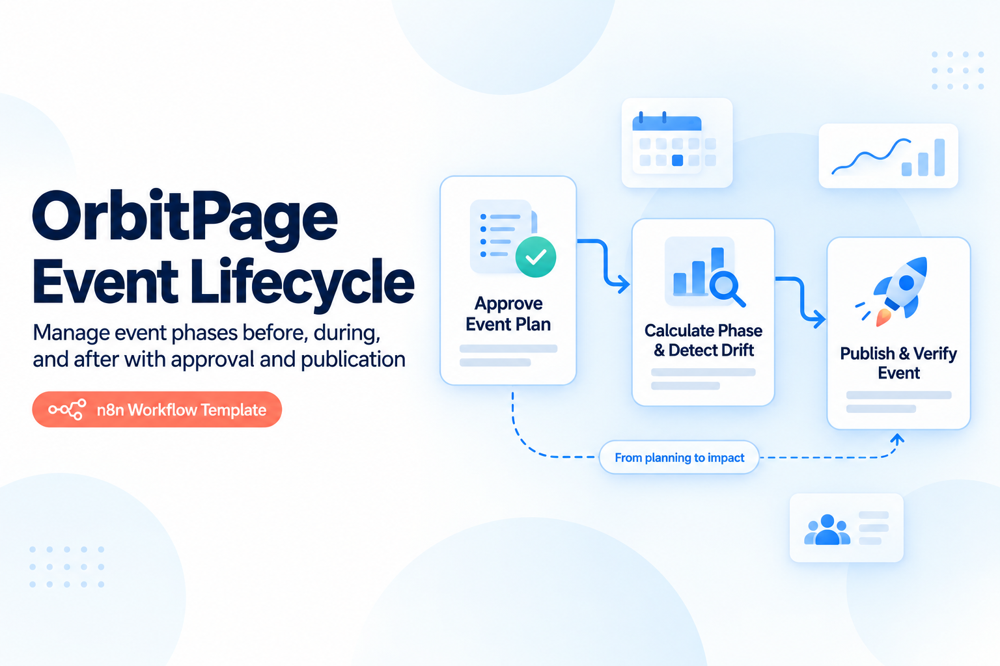
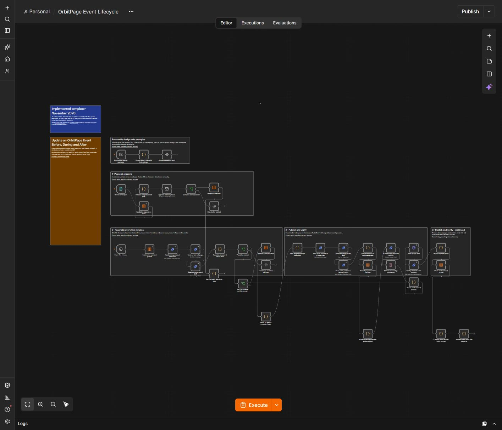

# Update an OrbitPage Event Before, During and After

Publish approved event phases at one stable URL, with guarded revisions, a durable journal and a reusable local QR.

## How it works

Submit a complete versioned event plan through the owner form. SMTP review shows all three phase snapshots and absolute timestamps. Approval saves the exact plan; a five-minute schedule selects the current phase, including after downtime. It reads the complete baseline, claims the journal, saves the merged native subpage collection privately, verifies the entire result, publishes the exact revision and checks the public HTML before recording success. The final output includes a locally generated SVG QR for the stable event URL.

## Input and operating rules

Paste [example-input.json](./example-input.json) into the **event_plan** form field and replace dates, facts and HTTPS destinations. Timestamps require an explicit UTC offset. The timezone is descriptive; the supplied instants determine transitions. Titles and descriptions must be trimmed, non-empty strings. Before start selects **before**, start inclusive selects **during**, end inclusive selects **after**.

One imported workflow and journal owns one event. Keep its id and slug, increment version for any reviewed change, and submit all three phase snapshots again. Set paused=true in a new reviewed version to suspend transitions. A repeat of the identical approved plan or already verified phase performs no mutation. Use a separate workflow and separately named journal for another event.

An approved phase may publish the workspace. The workflow refuses pre-existing unpublished changes and owned subpage drift. Do not share the intake form publicly. The QR is stable because the subpage slug stays fixed; it does not route through a tracking provider.

## First run

Run the setup companion, configure all table/credential/email fields, and test the form with dates suitable for your test workspace. Confirm the approval link, run the schedule branch, inspect the native subpage and the **Verified event result and stable QR** output. Test each date boundary before enabling the five-minute schedule.

## Workflow canvas

## Requirements and setup

1. Use an n8n installation supporting native Data Tables, Form Trigger, SMTP send-and-wait and the **n8n-nodes-orbitpage** community package. This release was verified with **n8n 2.43.6** and package **0.3.6**. Follow the [OrbitPage package installation guide](https://github.com/paoloronco/n8n-nodes-orbitpage/blob/main/docs/guides/getting-started.md). Community package installation must be available on your n8n plan.
2. Connect an OrbitPage workspace with the required features and a token scoped to **workspace:read, publication:read, publication:write, pages:read, pages:write**. Confirm your plan exposes subpages or detailed analytics/AI as applicable. The public HTTPS page must be reachable from n8n.
3. Import **setup-journal.json**. For each additional imported instance, first give its Create-table node a distinct table name. Run it once to create six string columns and exactly one control row. A second run stops rather than resetting history. Record the resulting table id.
4. Import **workflow.json**. Select that table in **every** Data Table row node listed below. Do not share a journal between templates or workspace credentials. Keep the single control row; do not manually duplicate it.
5. Select your OrbitPage credential on every OrbitPage node and your SMTP credential on every Send Email node. Replace all **REPLACE_WITH_SENDER_EMAIL** and **REPLACE_WITH_OWNER_EMAIL** values with your verified sender and one owner inbox.
6. Protect intake forms for the owner and ensure n8n's approval resume URLs are reachable through your normal authenticated deployment. For self-hosted n8n, configure its externally reachable webhook URL and test an actual approval email. Avoid production customers while checking your setup.
7. Run the relevant first-run checks, then activate the appropriate production triggers. The imported workflow starts inactive while **all individual nodes are enabled**. Success/error execution data is not retained by default; maintain private diagnostics appropriate for your environment.

### Select the same journal in these nodes

- Store approved plan
- Read active plan and journal
- Reserve transition intent
- Read plan registration state
- Persist prepared event revision
- Store verified event journal

## Concurrency and recovery

Use one writer at a time per OrbitPage workspace. Revision/ETag checks reject concurrent changes rather than overwrite them. The native control row uses conditional updates plus exact execution-owner/record verification; it is not a general-purpose distributed locking service. Other workflows and dashboard edits may cause a conflict requiring fresh review.

Normal reads may retry. Mutating operations, AI requests/commits and SMTP delivery do not automatically retry. A pending/review journal protects against uncertain provider outcomes. A failed execution can deliberately leave this journal busy.

Before retrying, inspect the control row's state/snapshot and the failed node privately. Compare current publication and the full draft with the saved baseline and intended revision. Never simply clear pending state or republish an unknown outcome. A normal rerun only reconciles an already-public exact intended result after read-back verification. If the private draft or content has changed, stop, reconcile it in OrbitPage and request a new review. Expired review locks may require supervised release after verifying that no mutation occurred. Back up the row before any manual correction.

Campaign publication is recorded before email. If sending fails or acceptance is unknown, verify publication and SMTP logs, then resend the saved files manually if required. Replaying the same brief will not automatically send a duplicate. A 250 SMTP acceptance means the sending server accepted the message; it does not prove inbox delivery.

Journal snapshots may contain private business content. Keep them in your n8n project. Do not publish previews, logs, credential references or populated journals with a shared template.

## Files and validation

- **workflow.json** — executable import, without credentials or instance identifiers.
- **setup-journal.json** — native one-time journal creation.
- **README.md** — setup, examples, operation and recovery.
- **VALIDATION.md** — actual acceptance scope and boundaries.
- **cover.png / thumbnail.png** — original design-edition artwork, reused.
- **example-input.json** — editable form payload.
- **THIRD_PARTY_NOTICES.md** — embedded QR library MIT attribution.

See [validation](./VALIDATION.md) and the [dependency-free checks](../tests/README.md). No ad spend, purchase or paid third-party QR service is required by this template. Your n8n, SMTP, OrbitPage plan and any AI allowance are separate services.

[More OrbitPage templates](../README.md)
