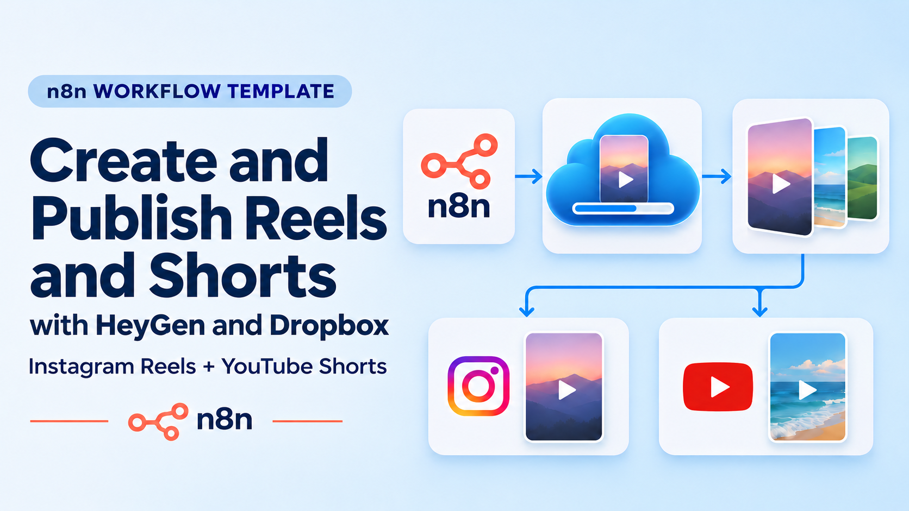

# Create and Publish Reels & Shorts with HeyGen and Dropbox

Create narrated vertical videos with **HeyGen Cloud / HyperFrames**, optionally archive the original MP4 in **Dropbox**, and deliver it to **Instagram Reels** and **YouTube Shorts** from one n8n workflow.

The workflow uses stock n8n nodes. **No worker, FFmpeg, Python, browser engine or additional packages need to be installed on the n8n host.** Rendering runs on HeyGen's infrastructure. n8n prepares the project, manages state and moves the original media between services.

[Download JSON](automate-cloud-video-production.json) · [Download ZIP](cloud-video-production-n8n.zip) · [Example brief](example-brief.json) · [Validation results](TEST-RESULTS.md)

## How it works

1. Submit your own structured brief through a Basic Auth protected form, or use the included neutral English example.
2. Validate narration, scenes, destination identities and limits. Reserve a slot in a persistent render-count ledger before generating anything.
3. Read the API wallet and voice catalog, request narration, and validate the returned WAV. Build a self-contained HTML project in n8n with bundled fonts, GSAP and optional downloaded images.
4. ZIP the project, upload it using a signed S3 URL, submit a high-quality HyperFrames render and poll the saved render ID. Check the resulting MP4 metadata and calculate its SHA-256.
5. If enabled, upload that verified original MP4 to Dropbox. Save its file ID, path, revision and hash in the job checkpoint. A stable filename makes retries overwrite the same destination.
6. Technically valid videos enter automatic delivery without per-video approval. At a publishing slot, claim one due job, verify the intended accounts and publish its selected channels. Preserve each provider ID and processing receipt.
7. Recover failed stages using the existing job and render IDs. An uncertain upload requires reconciliation before another write; a completed channel is not repeated.

The template supplies a simple, neutral explainer/slideshow layout. It contains no customer campaign, website capture, proprietary video preset, brand asset or prerecorded promotional media. It does not create editorial briefs automatically.

## Setup

### Requirements and credentials

Use an n8n version with Data Tables and the stock Webhook, HTTP Request, Code, Crypto, Compression, Extract from File, Schedule, Dropbox, Facebook Graph API and YouTube nodes. A publicly reachable HTTPS n8n URL is required for forms and signed media delivery. No community nodes are used.

| Connection | Purpose |
| --- | --- |
| HeyGen Header Auth | API wallet/voices, narration, project upload and managed rendering. Use `X-Api-Key` with your own API key, as described in [HeyGen authentication](https://developers.heygen.com/docs/api-key.md). Select it on all five authenticated rendering HTTP nodes. |
| Basic Auth | Protect both intake and recovery forms with one dedicated credential. |
| Dropbox OAuth2 | Optional original-MP4 archive. Connect the native Dropbox node with file read/write access. Create the destination folder first. |
| Facebook Graph OAuth2 | Optional Instagram publishing through the official API. Requires a supported professional account and the appropriate Meta permissions. |
| YouTube OAuth2 | Optional upload, account identity and processing checks for your own channel. |

All credential IDs and personal account bindings have been removed. Select your own credentials after import. Configure every enabled integration before activating the workflow; n8n may flag unbound credential selectors even when that service is not selected for a brief.

### Configure the workflow

1. Import [automate-cloud-video-production.json](automate-cloud-video-production.json) and keep it inactive.
2. Edit **Apply video configuration**. Set `publicN8nBaseUrl`, a dedicated `jobsTable`, `defaultBrand`, the intended social account IDs/usernames and `defaultTargets`. Keep `renderer: "heygen"` and `rendererBaseUrl: "https://api.heygen.com"`.
3. For Dropbox, create `/Video Archive` or your own folder, select your Dropbox OAuth2 credential in **Upload video to Dropbox**, set `dropboxFolder` and turn `dropboxEnabled` on. When enabled, archiving must succeed before social delivery.
4. With `manualAction: "setup"`, execute **Set up cloud storage** once. It initializes the jobs table and ledgers without submitting a video. Repeated setup preserves the existing ledgers. Use separate table names and webhook paths for staging copies.
5. Keep `allowExistingApiCredits: false` and `publishingEnabled: false` while checking configuration. The generation planner then stops before dispatching a provider request for a new job.
6. When you independently authorize API usage, set `allowExistingApiCredits: true`. To submit the sample, temporarily set `manualAction: "example"` and run the same Manual Trigger; restore `"setup"` afterwards. This is a real generation when enabled and may consume credits.
7. Verify the actual configured provider and accounts before production. For a private YouTube test select YouTube only and set `privateTest: true`; Instagram cannot be included in a private test.
8. Set `publishingEnabled: true` only when delivery is intended, then publish/activate in your n8n instance. This is separate from any n8n Creator Portal submission.

### Entry points and schedule

Under your configured public n8n URL:

| Path | Behavior |
| --- | --- |
| `/webhook/video-intake` | Protected GET brief form / POST brief submission. |
| `/webhook/video-recovery` | Protected GET recovery form / POST existing-job recovery. |
| `/webhook/video-review` | Private status and original-media preview using the job capability. |
| `/webhook/video-decision` | Optional manual decision endpoint; disabled by the default automatic policy. |
| `/webhook/video-media` | Expiring, authorized access to the verified original MP4. |

The generic schedule checks the ready queue at **08:00 UTC** and claims one due video at **09:00 UTC**. Empty queues do nothing. Set the n8n workflow timezone, both Schedule nodes and the configuration's `timezone` / `hours` together if you change these times. A brief's `publishAt` is its earliest delivery time, not an immediate-post command.

## Customization

Use [example-brief.json](example-brief.json) as the input schema. Supply a title, brand, narration, caption, two to five scenes and explicit destinations. Supported formats are `explainer` and `slideshow`; slideshow requires a public HTTPS PNG, JPEG or WebP URL for every scene. The neutral layout and typography live in **Build self-contained project**; adapt those functions to your own visual identity.

Output targets **1080 × 1920, 30 fps, H.264/AAC MP4**, using HeyGen's `high` rendering quality. Narration is English. Scene durations are shared equally across the narration duration; the example is a starting point, not an editorial-quality guarantee for arbitrary text or images.

`requireVideoApproval: false` is the distributed default. Successful technical checks bind the exact file, complete brief and destination identities automatically. For deployments requiring manual review, set it to `true`: the retained review/decision branches then require an explicit decision before delivery. Changing file bytes, targets or account identities invalidates the saved authorization.

Choose Instagram, YouTube, both, or neither. With no social targets, the workflow produces a master video for preview/download and optional Dropbox storage. Dropbox does not create a public share link; social media delivery uses the workflow's authorized media endpoint.

## Recovery

Keep job IDs, private recovery tokens and provider receipts. The recovery form resumes saved work: it polls a known render again, preserves completed channels and records archive failures. If narration may have succeeded without an acknowledgement, provide its existing WAV URL instead of generating it again.

Instagram container creation/publication and YouTube uploads are checkpointed before the write. Lost acknowledgements enter reconciliation state; supply the existing provider ID before retrying. Do not delete receipts to force another upload. Dropbox uses `<jobId>-<SHA256-prefix>.mp4`; retries overwrite that destination, and a saved matching receipt skips a repeat upload.

Slot and job claims use conditional Data Table updates. If Instagram succeeds and YouTube fails, recovery continues with the remaining channel. Tokens and signed media URLs must remain private. Protect n8n's saved execution data and configure suitable retention: it can contain briefs, media and recovery capabilities.

## Additional info

**Disabled generation is the cost-free state.** `allowExistingApiCredits` is not a promise of free rendering. Enabling it authorizes calls against the configured API wallet. The workflow checks for a funded wallet with automatic reload disabled, uses a configured job cap and implements no subscription purchase, top-up or paid fallback. The default `maxCloudRenders: 1` is a lifetime count of distinct jobs in that ledger, not a currency budget. Do not erase the ledger to reset it inadvertently.

HeyGen website-plan generations and API credits are separate. The explicitly selected speech model, `heygen-voice-1-turbo-free`, is promotional and can stop being available; the workflow fails rather than silently switching to a paid model. Check the current [speech documentation](https://developers.heygen.com/docs/voices/heygen-voice-speech.md) and your own API entitlement before enabling generation. Managed rendering itself can be billed; see the [HyperFrames render API](https://developers.heygen.com/reference/create-hyperframes-render).

Limits: 700 narration characters, 3–60-second final video, 3 MiB per image, 12 MiB narration, 8 MiB project ZIP and 40 MiB MP4. n8n validates WAV/MP4 metadata and hashes; it does not fully decode the final MP4, assess editorial clarity or measure encoded loudness. Provider availability, permissions and account setup remain deployment requirements.

See [TEST-RESULTS.md](TEST-RESULTS.md) for the cost-free checks and their limits. No successful live HeyGen render or cloud social publication is claimed for this release. The old local adapter and promotional preview media are excluded. Bundled third-party fonts and GSAP retain their notices in [LICENSES](LICENSES).
